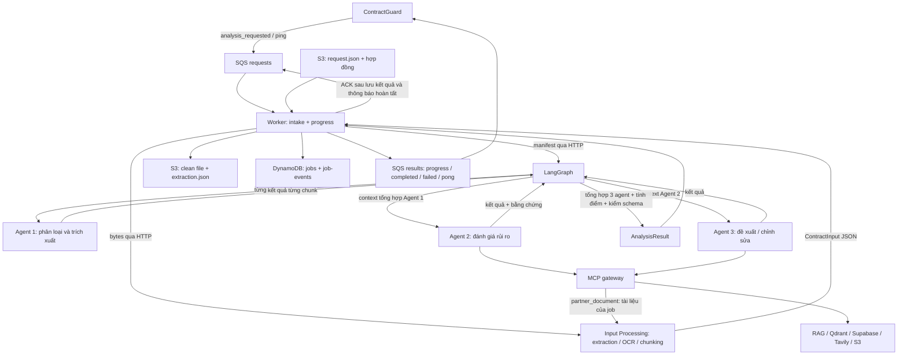
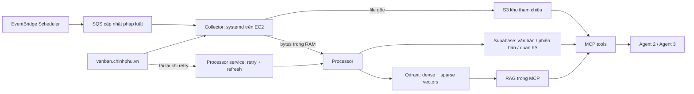

# Contract Risk Management AI

Hệ thống phân tích rủi ro hợp đồng với ba AI agent, điều phối bằng LangGraph và tích hợp ContractGuard qua AWS SQS/S3. Worker nhận yêu cầu, tiền xử lý hợp đồng, chạy các agent, lưu kết quả và cập nhật tiến độ. Luồng dữ liệu pháp luật riêng cung cấp bằng chứng cho Agent 2/3 qua MCP và RAG.

Tài liệu mô tả source code tại **2026-11-18**. Hướng dẫn GitHub → EC2 → khởi chạy: **[docs/ec2_setup_guide.md](docs/ec2_setup_guide.md)**.

## Luồng phân tích hợp đồng



LangGraph chuyển context giữa các agent; các container agent không import để gọi lẫn nhau. Output Agent 3 quay về LangGraph để dựng kết quả chung rồi mới trả worker.

| Thành phần | Trách nhiệm và dữ liệu bàn giao |
| --- | --- |
| Worker | Hai tiến trình intake/progress; SQS, tải S3, runtime ID, lease/heartbeat, gọi processing và LangGraph, ghi tiến độ/kết quả, ACK |
| Input Processing | Nhận bytes/text; kiểm định dạng/giới hạn; đọc TXT/PDF/DOCX/ảnh và OCR; làm sạch, giữ nguồn/trang, chia chunk; trả `ContractInput` |
| Agent 1 | Xử lý từng chunk, phân loại/trích xuất điều khoản, kiểm nguồn; cache đủ kết quả rồi tổng hợp cho Agent 2 |
| Agent 2 | Đánh giá điều khoản, gọi tool lấy bằng chứng, trả findings/checks và phần thiếu bằng chứng |
| Agent 3 | Đề xuất giảm thiểu/chỉnh sửa, đọc tài liệu gốc qua `partner_document` khi cần; đối chiếu findings của Agent 2 |
| LangGraph | Thứ tự chạy, handoff, retry lỗi tạm thời, cache/resume, dọn memory ngắn hạn; tính điểm tất định và dựng `AnalysisResult` |
| MCP | Tool gateway cho Agent 2/3; RAG pháp luật, Qdrant, Supabase, PostgreSQL tùy chọn, Tavily và đọc S3 |
| Monitoring | Sự kiện HTTP, log JSON, SQLite/outbox, metrics/alerts; chuyển tiến độ cho worker; Langfuse OTLP tùy chọn |
| Config | Cấp secret theo token và allowlist của từng service từ AWS Secrets Manager |

Model provider dùng **OpenAI Responses API**. Mặc định trong `config.yaml`: Agent 1 `gpt-6-luna`, Agent 2/3 `gpt-6.1-sol`; ghi đè bằng `AGENT_1_MODEL`, `AGENT_2_MODEL`, `AGENT_3_MODEL` hoặc `OPENAI_MODEL`. Đây là cấu hình repository; quyền truy cập model cần kiểm tra bằng tài khoản triển khai.

## Luồng dữ liệu pháp luật



`data_pipeline/` chạy bằng **hai service systemd với venv riêng**, ngoài Compose. Collector thu thập Hiến pháp và Luật/Bộ luật; S3 chỉ lưu file gốc. Processor nhận bytes trực tiếp, chuẩn hóa, phân tách Điều, quản lý phiên bản/hiệu lực và ghi Supabase/Qdrant. Processor service xử lý retry và cập nhật hiệu lực theo lịch. Luồng này không xử lý hợp đồng người dùng.

RAG dùng `intfloat/multilingual-e5-large` (1024 chiều), dense + sparse search, lọc hiệu lực/phiên bản, gộp phần của cùng Điều và rerank bằng `jinaai/jina-reranker-v2-base-multilingual`. Model chạy CPU từ `models/`; không cần embedding API key. Xem [thiết kế pipeline](docs/data_pipeline_design.md) và [RAG](docs/rag.md).

## Cấu trúc repository

```text
contract-risk-management/
├── agents/
│   ├── agent_1_classification/   # Agent, config, prompts, context, schemas, memory, tools
│   ├── agent_2_risk_scoring/
│   ├── agent_3_recommendation/
│   ├── hermes/                  # Adapter + hermes_agent/ (source upstream)
│   ├── memory/                  # Memory và CLI duyệt bài học
│   └── shared/                  # Context, schema validation, tools dùng chung
├── common/                      # Schema, settings, ports, auth/HTTP, durable job queue
├── config/                      # Secret broker, bootstrap và policy.json
├── configs/memory.yaml          # Ngân sách context/tóm tắt từng agent
├── data_pipeline/               # Collector, processor, ingestion, migrations SQL
├── input_processing/            # Validation, extraction/OCR, chunking, HTTP service
├── integrations/                # OpenAI, MCP client, embedding, PostgreSQL
├── mcp_server/                  # Tool gateway và các reader dịch vụ
├── monitoring/                  # Collector, tracing, metrics, alerts, Langfuse exporter
├── orchestration/               # LangGraph, handoff, cache, retry, scoring, output builder
├── rag/                         # Retrieval, filters, hybrid search, rerank, evidence
├── workers/                     # Hai tiến trình, AWS connectors, ContractGuard protocol
├── infrastructure/
│   ├── docker/Dockerfile        # Nhiều target: 9 image runtime + image test
│   ├── requirements/            # Dependency .in và lock .txt theo image/pipeline
│   ├── ec2/                     # Setup, deploy, preflight, rollback, systemd units
│   └── aws/                     # IAM policy tham khảo
├── scripts/                     # init_env.py, download_models.py, preprocess_contract.py
├── tests/                       # Unit, integration, notebook từng agent và tổng thể
├── docs/                        # Kiến trúc, giao thức, vận hành và lịch sử kiểm thử
├── models/                      # Model tải trước, không commit Git
├── docker-compose.yml           # Compose duy nhất: 9 service
├── .env.example                 # Mẫu cấu hình host; .env thật không commit
└── pyproject.toml               # Python package và dependency nền
```

Source Hermes upstream được giữ nguyên. `__init__.py` rỗng là dấu package Python. [Biên bản dọn project](docs/project_cleanup.md) giải thích các file rỗng đã xóa và những file cố ý giữ lại.

## Schema và dữ liệu bàn giao

| Ranh giới | Định nghĩa chính |
| --- | --- |
| ContractGuard → worker | `common/schemas/business/inbound.py`: `InboundMessage`, `AnalysisRequest`; giữ toàn bộ request vào `context.request` |
| Processing → LangGraph | `common/schemas/contract.py`: `ContractInput`, `ContractChunk`; `contract_id`, `contract_version`, chunks và metadata nguồn |
| Agent input/output nghiệp vụ | `agents/<agent>/schemas/input.py`, `output.py`: `ClassificationResult`, `RiskScoringResult`, `RecommendationResult` |
| Envelope model | `common/schemas/agent_messages.py`: `AgentResult` gồm `agent_id`, `text`, `usage`, `stop_reason`; `text` chứa JSON nghiệp vụ được kiểm tra |
| LangGraph → worker → ContractGuard | `common/schemas/business/outbound.py`: `AnalysisResult` (`schema_version=2.0.0`), `OutboundMessage`; dựng tại `orchestration/extraction.py` |

`job_id`, `runtime_id`, `trace_id`, `request_id` liên kết xử lý/monitoring theo từng phạm vi. Worker tạo runtime ID khi message thiếu. Cache/retry kiểm scope và execution revision; SQLite/Docker volumes phục vụ một host, không bảo đảm model chỉ được gọi đúng một lần trong mọi sự cố.

DynamoDB `contract-risk-jobs` lưu trạng thái hiện tại, khóa `job_id` (String). `contract-risk-job-events` lưu lịch sử thêm mới, khóa `job_id` + `event_id` (String). Cập nhật chịu kiểm soát runtime/lease/sequence. Xem [worker](docs/workers.md) về giao thức nội bộ và chế độ ContractGuard khi có `WORKER_RESULTS_QUEUE_URL`.

## Cấu hình và lưu trữ

- `.env`: region, queue/bucket/table, token bootstrap `CONFIG_TOKEN_*`, model override và tùy chọn vận hành. Tạo từ `.env.example`, không commit.
- AWS API dùng IAM role trên EC2. API keys và token nghiệp vụ nằm trong secret `contract-risk/prod/api-keys`, cấp theo `config/policy.json`; không đặt vào image.
- `agents/<agent>/config.yaml`: model/inference. `prompts/`: chỉ dẫn cố định do dev quản lý; context là dữ liệu động. `configs/memory.yaml`: ngân sách theo bộ đếm ước lượng của project, không phải usage token thực tế từ OpenAI.
- Bảy named volume Docker lưu HTTP jobs, workflow/cache, memory agent và monitoring; `models/` mount chỉ đọc cho MCP. Giữ volumes khi cập nhật ứng dụng.
- API service nằm trong mạng Compose; monitoring bind loopback host `127.0.0.1:8099` mặc định để data pipeline gửi sự kiện.

Prompt nghiệp vụ và prompt nén ngắn hạn đã có nội dung. Ba file `memory/long_term_reflection.md` còn trống nên bước tự đề xuất bài học được bỏ qua; kho bài học và CLI duyệt vẫn có. Danh mục `BR-RISK-006`, `BR-RISK-007`, `fact_keys` chờ đối tác. Không tự suy diễn nội dung còn thiếu.

## Chạy trên máy phát triển

Dùng Python 3.12 để cùng môi trường với Docker; Docker Engine/Compose ≥ 2.24 nếu chạy stack. Từ root repository:

```sh
python3.12 -m venv .venv312
. .venv312/bin/activate
python -m pip install -r infrastructure/requirements/test.txt -r infrastructure/requirements/mcp.txt -r infrastructure/requirements/data_pipeline.txt
python -m pip install --no-deps -e .
python -B -m unittest discover -s tests/unit -p 'test_*.py' -v
```

Windows: tạo venv bằng `py -3.12 -m venv .venv312`, kích hoạt `.\.venv312\Scripts\Activate.ps1`. Chạy từ source checkout vì Hermes, prompt/config và migrations không được đóng thành wheel triển khai độc lập.

Chạy Compose local; tạo `.env` **chỉ khi chưa có**:

```sh
python scripts/init_env.py
python scripts/download_models.py
docker compose config --quiet
docker compose build
docker compose up -d --wait --wait-timeout 180
docker compose ps
```

`init_env.py` tạo `APP_ENV=local`, `MODEL_PROVIDER=fixture`, `WORKER_ENABLED=false`. **Local Compose vẫn cần credential đọc Secrets Manager**; fixture chỉ thay model và tắt polling worker. Unit test dùng mock/Moto, không cần tài khoản cloud. Dùng queue thử riêng khi kiểm thử gửi job.

Notebook từng agent và tổng thể chạy test offline có sẵn; không đánh giá chất lượng model thật. Xem [tests/README.md](tests/README.md) để chọn test/notebook và [docs/testing.md](docs/testing.md) cho lịch sử kiểm thử container.

## Triển khai và vận hành

Làm theo [hướng dẫn EC2](docs/ec2_setup_guide.md): GitHub → clone vào `/opt/contract-risk-management` → `.env` → `models/` → build → kiểm IAM/secret/readiness → bật worker. Data pipeline có bước systemd và migration riêng.

```sh
docker compose ps
docker compose logs --tail 100 worker input-processing langgraph monitoring
docker compose exec worker python -m workers --check-config
docker compose down  # Dừng stack và giữ named volumes
```

Thay `.env` cần recreate service bằng `docker compose up -d`; đổi secret runtime cần restart service liên quan. Giữ tag image cũ và backup dữ liệu trước thay đổi schema/cache.

Giới hạn hiện tại: cần nghiệm thu model/AWS thật trên môi trường đích; chưa có cơ chế Agent 2/3 tải lại toàn bộ output khi handoff bị nén; chưa có retention chung cho workflow cache; sự cố S3 tại thời điểm lease hết cần kiểm chứng thêm. Báo cáo kiểm thử cũ không thay cho kiểm thử image build từ checkout mới.

## Tài liệu

| Nội dung | Tài liệu |
| --- | --- |
| Deploy EC2, update, rollback, systemd | [EC2 setup guide](docs/ec2_setup_guide.md) |
| Kiến trúc và giao tiếp container | [Architecture](docs/architecture.md), [Container interfaces](docs/container_interfaces.md) |
| Environment, Secrets Manager | [Environment](docs/environment.md) |
| Worker, tiền xử lý | [Workers](docs/workers.md), [Input processing](docs/input_processing.md) |
| Prompt, memory, workflow | [Agent core](docs/agent_core.md), [Agent workflow](docs/agent_workflow.md) |
| MCP, RAG, dữ liệu pháp luật | [MCP](docs/mcp.md), [RAG](docs/rag.md), [Data pipeline](docs/data_pipeline_design.md) |
| Monitoring và Langfuse | [Monitoring](docs/monitoring.md), [Langfuse](docs/langfuse_monitoring.md) |
| Test và kiểm tra image | [Tests](tests/README.md), [Testing history](docs/testing.md), [EC2 readiness history](docs/ec2_readiness.md) |
| Phân loại file rỗng | [Cleanup](docs/project_cleanup.md) |

[folder-responsibilities.md](docs/folder-responsibilities.md) là bản thiết kế gốc được giữ nguyên; các tên folder/dịch vụ lịch sử trong đó không mô tả runtime hiện tại.
