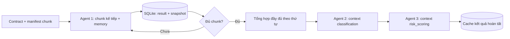

# LangGraph, Hermes memory và Langfuse

## Luồng thực thi



LangGraph định nghĩa các node trong `orchestration/workflow.py`.
`ContractInput` yêu cầu contract ID, version, danh sách chunk và expected_chunk_count.
Index phải liên tục từ 0, ID chunk không trùng, text không rỗng. Cần cung cấp đúng
expected_chunk_count từ bước chia file để phát hiện cả trường hợp thiếu chunk cuối.

## Memory cho ba agent

Plan của ba agent nằm tại `agents/agent_1_classification/plan.md`,
`agents/agent_2_risk_scoring/plan.md` và `agents/agent_3_recommendation/plan.md`.
Agent 2 nhận classification tổng hợp; Agent 3 nhận risk_scoring. Plan Agent 2/3
bổ sung luồng database qua MCP → kiểm tra đủ bằng chứng → search web qua MCP nếu
thiếu → đánh giá/đề xuất → cache → tổng hợp/bàn giao → dọn memory riêng.
Mỗi plan giữ điểm thiếu, nguồn và liên kết điều khoản; hết ngân sách tìm kiếm không
đồng nghĩa đủ cơ sở kết luận. MCP chỉ sử dụng tool/schema được cấu hình theo
[mô hình tool của MCP](https://modelcontextprotocol.io/docs/learn/server-concepts).

Các plan mô tả hành vi mục tiêu. Runtime hiện chưa triển khai MCP client, vòng lặp
tool, cache tiến độ/bằng chứng từng mục, schema nghiệp vụ hay dọn snapshot/checkpoint.
Nạp `plan.md` vào instructions không tự tạo các chức năng đó. Endpoint, binding MCP,
credential, ngân sách tìm kiếm và quy tắc riêng vẫn cần được cấu hình sau.

`hermes_integration/context_engine.py` triển khai lớp con của
`agent.context_engine.ContextEngine` trong source Hermes thật. Lớp tích hợp gọi
engine trực tiếp quanh lần gọi Bedrock của BaseAgent; không khởi động Hermes CLI,
AIAgent tool loop hoặc bộ nhớ người dùng toàn cục.

- Agent 1: trước chunk tiếp theo, khôi phục snapshot từ chunk trước đã lưu thành công.
  Context gồm system instructions, summary cũ nếu có, các turn gần nhất và chunk hiện tại.
- Agent 2: memory riêng, đầu vào là aggregate classification của toàn bộ hợp đồng.
- Agent 3: memory riêng, đầu vào là output Agent 2.
- Kết quả và snapshot sau mỗi lần gọi thành công được lưu cùng một row SQLite.
  Không ghi thành công khi model lỗi, trả rỗng hoặc bị cắt output.

## Giới hạn context và tổng hợp

Điền `max_input_tokens` và `summary_max_tokens` cho mỗi agent trong
`configs/memory.yaml`; phải dành phần context window còn lại cho output và overhead.
Các giá trị phụ thuộc model nên chưa có mặc định. Có thể truyền
`policies={agent_id: MemoryPolicy(...)}` khi tạo pipeline.

Counter mặc định dùng số byte UTF-8 cộng overhead ước lượng, có chủ đích bảo thủ,
không phải tokenizer chính xác của model. Có thể inject `counter(messages) -> int`
theo model được chọn. Các số test không phải ngân sách khuyến nghị cho production.

Khi lịch sử vượt ngân sách, engine gọi ModelMemorySummarizer để rút gọn turn cũ,
giữ các turn gần nhất nếu vừa ngân sách. Summary tiếp tục được mang sang các chunk sau.
Nếu cần, cả turn gần nhất cũng có thể được tóm tắt để dành chỗ cho chunk mới.
System instructions và chunk đang xử lý không bị cắt bỏ.

Prompt nén nằm ở `agents/shared/prompts/compact_memory.md`, hiện chỉ có TODO.
Model tóm tắt dùng cùng Bedrock provider của agent nhận context. Input quá lớn được
chia thành phần vừa ngân sách rồi tóm tắt nhiều tầng; mọi phần được đưa vào bước xử lý.
Summary không thu nhỏ, không hoàn chỉnh hoặc chunk hiện tại vẫn quá lớn sẽ gây lỗi
rõ ràng, không đánh dấu hợp đồng hoàn tất.

Cache giữ nguyên kết quả từng chunk. Aggregate là danh sách có thứ tự, kèm chunk ID,
metadata nguồn và output đầy đủ; chưa có luật nghiệp vụ để merge/xóa điều khoản trùng.
Nếu aggregate vượt ngân sách của Agent 2, context nhận summary kèm cache key,
source stage và số chunk; bản aggregate đầy đủ vẫn ở cache. Agent 3 dùng cùng cơ chế
nếu output Agent 2 quá lớn. Summary có thể mất chi tiết về mặt ngữ nghĩa; chất lượng
cần đánh giá sau khi điền prompt, schema và dữ liệu đánh giá. Không có tool tự đọc lại
cache trong vòng suy luận ở phiên bản này.

## Cache, checkpoint và chạy lại

- SQLite mặc định: `.cache/contracts.sqlite3`; inject `ContractCache(path)` để đổi đường dẫn.
  `ContractCache()` không truyền path là cache RAM, phù hợp unit test.
- Key phân biệt job ID + contract ID + version. Job ID phải được cấp duy nhất trong
  phạm vi ứng dụng/tenant; backend cần bổ sung phân quyền khi nối API.
- Fingerprint bao gồm toàn bộ chunk/context, model, ngân sách, prompt và cấu hình inference.
  Không dùng lại job với input/cấu hình khác. Thay đổi code, tokenizer, handler hoặc
  summarizer tùy biến cần đổi `cache_revision` hoặc job ID.
- Lỗi ở chunk N: gọi lại `run_contract` với cùng input/job/cache; các chunk đã lưu được
  bỏ qua, snapshot trước N được khôi phục. Agent 2/3 đã lưu cũng được dùng lại.
- LangGraph dùng InMemorySaver theo thread_id mặc định. Có thể inject checkpointer
  bền vững sau; cache SQLite vẫn cho phép phục hồi qua lần khởi động process mới bằng
  cách chạy lại graph và dùng các kết quả đã lưu.
- Khóa chống chạy trùng hiện nằm trong một instance ContractCache. Thiết kế này dành
  cho một process/worker; nhiều process/máy cần distributed lock và backend cache chung.
- Nếu process chết sau model trả lời nhưng trước khi commit cache, lần gọi đó có thể
  phải thực hiện lại. Chưa có đảm bảo exactly-once cho API model.
- Chưa tự động retry workflow; lỗi được đẩy lên caller. Đóng cache bằng `cache.close()`
  khi kết thúc sử dụng. Cần chính sách dọn cache/checkpoint khi vận hành lâu dài.

## Langfuse

Adapter trong `monitoring/langfuse.py` dùng Python SDK 5.1.x, được khai báo `>=5.1,<6`.
Điền `.env` tại root hoặc export các biến sau để bật (biến môi trường được ưu tiên):

```text
LANGFUSE_ENABLED=true
LANGFUSE_PUBLIC_KEY=<TODO>
LANGFUSE_SECRET_KEY=<TODO>
LANGFUSE_BASE_URL=<TODO>
```

Mặc định tắt hoàn toàn khi chưa bật LANGFUSE_ENABLED. Khi bật nhưng thiếu kết nối,
code báo ConfigurationError thay vì tự chọn một endpoint.

Mỗi lần chạy có trace ID mới; session ID ổn định theo job/contract/version liên kết các
lần tiếp tục. Root là `chain`, bước xử lý của ba agent là `agent`, từng lần gọi model
và tóm tắt memory là `generation`. Ghi model ID, latency, input/output/cache token usage,
cache hit và loại lỗi. Tool được gọi với observer tạo observation kiểu `tool`.

Mặc định chỉ ghi metadata, usage và thống kê input/output, không gửi prompt hoặc nội dung hợp đồng. Đặt
`LANGFUSE_CAPTURE_CONTENT=true` nếu muốn ghi input/output. Lỗi trong thao tác ghi trace
được log và không thay thế lỗi nghiệp vụ hoặc làm gọi lại model. Flush sau mỗi lần
chạy. Đã xác minh đường đi đầy đủ bằng dữ liệu giả lập và đọc lại trace từ Langfuse Cloud;
Bedrock vẫn dùng client giả trong lần xác minh này. Xem [hướng dẫn Langfuse](langfuse.md).

API đối chiếu: [LangGraph persistence](https://docs.langchain.com/oss/python/langgraph/persistence),
[Langfuse instrumentation](https://langfuse.com/docs/observability/sdk/instrumentation),
[Langfuse best practices](https://langfuse.com/docs/observability/best-practices).
Giao diện ContextEngine được đối chiếu trực tiếp với source Hermes trong repo.
