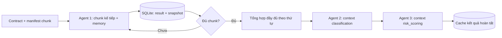

# LangGraph, Hermes memory và tiến độ workflow

## Luồng thực thi

Trong Compose, worker gửi ContractInput do processing service chuẩn hóa tới LangGraph.
Graph gọi RemoteAgent/RemoteSummarizer qua HTTP; node/cạnh, handoff, cache và memory
vẫn giữ nguyên. RPC trả AgentResult và memory snapshot. Full-result/memory cache nằm
trên volume để phục hồi, còn job HTTP có durable queue/lease. Không cần Docker Engine.
Caller Python vẫn có thể cung cấp ContractInput trực tiếp cho run_contract/run;
không khôi phục run_preprocessing_job trong orchestration.

LangGraph định nghĩa các node trong `orchestration/workflow.py`.
`ContractInput` yêu cầu contract_id, contract_version, danh sách chunk và expected_chunk_count.
Index phải liên tục từ 0, ID chunk không trùng, text không rỗng. Cần cung cấp đúng
expected_chunk_count từ bước chia file để phát hiện cả trường hợp thiếu chunk cuối.

## Memory cho ba agent

Plan của ba agent nằm tại `agents/agent_1_classification/plan.md`,
`agents/agent_2_risk_scoring/plan.md` và `agents/agent_3_recommendation/plan.md`.
Agent 2 nhận classification tổng hợp; Agent 3 nhận risk_scoring. Plan Agent 2/3
bổ sung luồng database qua MCP → kiểm tra đủ bằng chứng → search web qua MCP nếu
thiếu → đánh giá/đề xuất → cache → tổng hợp/bàn giao → dọn memory riêng.
Mỗi plan giữ điểm thiếu, nguồn và liên kết điều khoản; hết ngân sách tìm kiếm không
đồng nghĩa đủ cơ sở kết luận. MCP chỉ sử dụng tool/schema được cấu hình theo
[mô hình tool của MCP](https://modelcontextprotocol.io/docs/learn/server-concepts).

Các plan mô tả hành vi mục tiêu. Runtime hiện chưa triển khai MCP client, vòng lặp
tool, cache tiến độ/bằng chứng từng mục, schema nghiệp vụ hay dọn snapshot Agent 2/3 và
checkpoint toàn job. Dọn memory Agent 1 sau aggregate đã triển khai (xem [agent_1_flow.md](agent_1_flow.md)).
Nạp `plan.md` vào instructions không tự tạo các chức năng đó. Endpoint, binding MCP,
credential, ngân sách tìm kiếm và quy tắc riêng vẫn cần được cấu hình sau.

`agents/hermes/context_engine.py` triển khai lớp con của
`agent.context_engine.ContextEngine` trong source Hermes thật. Lớp tích hợp gọi
engine trực tiếp quanh lần gọi model (OpenAI) của BaseAgent; không khởi động Hermes CLI,
AIAgent tool loop hoặc bộ nhớ người dùng toàn cục.

- Agent 1: trước chunk tiếp theo, khôi phục snapshot từ chunk trước đã lưu thành công;
  snapshot phải có `scope` đúng contract_id/contract_version/chunk N−1, sai thì dừng trước khi gọi model.
  Context gồm system instructions, summary cũ nếu có, các turn gần nhất và chunk hiện tại.
- Agent 2: memory riêng, đầu vào là aggregate classification của toàn bộ hợp đồng.
- Agent 3: memory riêng, đầu vào là output Agent 2.
- Kết quả và snapshot sau mỗi lần gọi thành công được lưu cùng một row SQLite.
  Không ghi thành công khi model lỗi, trả rỗng hoặc bị cắt output.

## Giới hạn context và tổng hợp

Điền `max_input_tokens` và `summary_max_tokens` cho mỗi agent trong
`configs/memory.yaml`; phải dành phần context window còn lại cho output và overhead.
Các giá trị phụ thuộc model nên chưa có mặc định. Có thể truyền
`policies={agent_id: MemoryPolicy(...)}` khi tạo pipeline.

Counter mặc định dùng số byte UTF-8 cộng overhead ước lượng, có chủ đích bảo thủ,
không phải tokenizer chính xác của model. Có thể inject `counter(messages) -> int`
theo model được chọn. Các số test không phải ngân sách khuyến nghị cho production.

Khi lịch sử vượt ngân sách, engine gọi ModelMemorySummarizer để rút gọn turn cũ,
giữ các turn gần nhất nếu vừa ngân sách. Summary tiếp tục được mang sang các chunk sau.
Nếu cần, cả turn gần nhất cũng có thể được tóm tắt để dành chỗ cho chunk mới.
System instructions và chunk đang xử lý không bị cắt bỏ.

Prompt nén (short term) nằm ở `agents/<agent>/memory/short_term_summary.md` (riêng từng agent), đang để trống. Xem `docs/agent_core.md`.
Model tóm tắt dùng cùng OpenAI provider của agent nhận context. Input quá lớn được
chia thành phần vừa ngân sách rồi tóm tắt nhiều tầng; mọi phần được đưa vào bước xử lý.
Summary không thu nhỏ, không hoàn chỉnh hoặc chunk hiện tại vẫn quá lớn sẽ gây lỗi
rõ ràng, không đánh dấu hợp đồng hoàn tất.

Cache giữ nguyên kết quả từng chunk. Aggregate là danh sách có thứ tự, kèm chunk ID,
metadata nguồn và output đầy đủ; chưa có luật nghiệp vụ để merge/xóa điều khoản trùng.
Nếu aggregate vượt ngân sách của Agent 2, context nhận summary kèm cache key,
source stage và số chunk; bản aggregate đầy đủ vẫn ở cache. Agent 3 dùng cùng cơ chế
nếu output Agent 2 quá lớn. Summary có thể mất chi tiết về mặt ngữ nghĩa; chất lượng
cần đánh giá sau khi điền prompt, schema và dữ liệu đánh giá. Không có tool tự đọc lại
cache trong vòng suy luận ở phiên bản này.

## Cache, checkpoint và chạy lại

- SQLite mặc định: `.cache/contracts.sqlite3`; inject `ContractCache(path)` để đổi đường dẫn.
  `ContractCache()` không truyền path là cache RAM, phù hợp unit test.
- Key phân biệt job_id + contract_id + contract_version. Job ID phải được cấp duy nhất trong
  phạm vi ứng dụng/tenant; backend cần bổ sung phân quyền khi nối API.
- Fingerprint bao gồm toàn bộ chunk/context, model, ngân sách, prompt và cấu hình inference.
  Không dùng lại job với input/cấu hình khác. Thay đổi code, tokenizer, handler hoặc
  summarizer tùy biến cần đổi `cache_revision` hoặc job ID.
- Resume (`orchestration/checkpoint.py`): `resume_chunk` tìm chunk đầu tiên chưa có kết quả trong
  cache. Graph vào thẳng chunk đó; nếu Agent 1 đã đủ chunk thì vào thẳng aggregate → Agent 2.
  Agent 2/3 đã lưu được dùng lại. Cache SQLite là nguồn tiến độ bền vững duy nhất.
- InMemorySaver chỉ là state tạm của một lần chạy: `forget` xóa thread sau mỗi lần invoke (kể cả
  lỗi) để service langgraph không giữ toàn bộ hợp đồng trong RAM mãi mãi.
- Sau khi lưu `complete`: `release_run` xóa memory snapshot Agent 2/3 (giữ result/input_context).
  Memory Agent 1 đã được xóa ngay sau aggregate (xem [agent_1_flow.md](agent_1_flow.md)).
- Khóa chống chạy trùng hiện nằm trong một instance ContractCache. Thiết kế này dành
  cho một process/worker; nhiều process/máy cần distributed lock và backend cache chung.
- Nếu process chết sau model trả lời nhưng trước khi commit cache, lần gọi đó có thể
  phải thực hiện lại. Chưa có đảm bảo exactly-once cho API model.

## Retry nghiệp vụ (`orchestration/retry_policy.py`)

| Tầng | Retry | Điều kiện |
| --- | --- | --- |
| SDK `openai` | 2 lần (max_retries=2), timeout 120 s | SDK tự xử lý 408/409/429/5xx/kết nối |
| `OpenAIChatClient` | không retry, phân loại | RateLimit (trừ `insufficient_quota`), InternalServer 5xx, APIConnection/Timeout → `TransientModelError`; Authentication/BadRequest/hết quota giữ nguyên lỗi; `finish_reason` khác `stop` → `ModelResponseError` |
| `ServiceClient` HTTP | 3 lần, 0.2–0.4s | 429/5xx/transport |
| `JobStore.submit` | cho submit lại tối đa 3 attempt | error_type thuộc `RETRYABLE_JOB_ERRORS` (RemoteServiceError, TimeoutError, TransientModelError) |
| Node LangGraph classify/evaluate/recommend | `AGENT_STAGE_RETRY`: 3 lần, backoff 5s→60s, jitter | `is_transient`: dịch vụ không phản hồi hoặc job agent lỗi tạm thời |

Lỗi validate/cấu hình/output model (ModelResponseError, ConfigurationError, ValueError...) không retry.
Trước đây (thời Bedrock) throttling sau 3 lần SDK làm job agent lỗi `ClientError` vĩnh viễn (job không được
requeue); giờ được retry có backoff. Chưa có chính sách xóa cache/volume theo thời gian (retention).

## Theo dõi tiến độ nội bộ

`monitoring/observer.py` cung cấp giao diện callback mặc định không làm I/O.
`monitoring/worker_observer.py` giữ adapter sự kiện để dùng khi cấu hình transport
sau này; hiện không tự gắn vào worker hoặc pipeline. Mặc định graph chạy với
NullObserver, không gửi progress/output ra ngoài. Các sự kiện phải được caller
nối tường minh trong một bước triển khai tiếp theo.
Xem [worker, ACK và cấu hình EC2](workers.md).

Usage do OpenAI trả về (`prompt_tokens`, `completion_tokens`, ...) vẫn giữ trong kết quả và cache. Gỡ telemetry không thay đổi
memory, token budget, prompt, model provider hay logic LangGraph.
Giao diện ContextEngine được đối chiếu trực tiếp với source Hermes trong repo.
