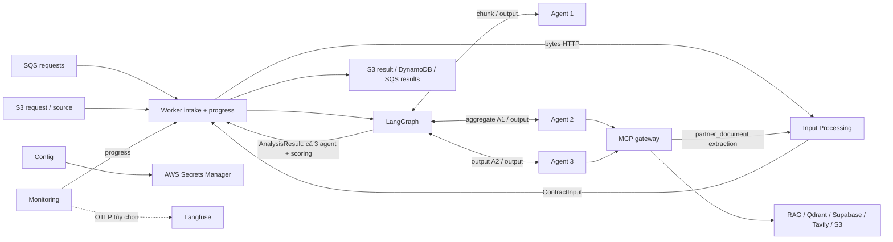

# Kiến trúc hiện tại — 2026-11-18

Một `docker-compose.yml` quản lý 9 service: worker, input-processing, agent-1/2/3, langgraph, monitoring, config và mcp. Dockerfile nhiều target nằm ở `infrastructure/docker/Dockerfile`. Data pipeline pháp luật là hai service systemd riêng trên cùng EC2.

## Ranh giới module

- `workers/`: AWS connectors và hai tiến trình; không import để gọi agent/processing. Hoàn tất job dựa vào kết quả LangGraph, lưu S3/DynamoDB và thông báo trước ACK. Langfuse không là kênh hoàn tất.
- `input_processing/`: xử lý bytes/text, validation/OCR/chunk/provenance; HTTP adapter trả `ContractInput`. Không tải S3 hoặc tự gọi Agent 1.
- `agents/`: BaseAgent, ba schema/prompt/context riêng; provider OpenAI Responses API, tool loop và kiểm output. `agents/hermes/` là adapter; `hermes_agent/` giữ source upstream.
- `orchestration/`: LangGraph gọi agent HTTP, kiểm revision, tổng hợp chunk, handoff, retry/cache/resume. Dựng `AnalysisResult` từ kết quả ba agent; tính điểm trong `scoring.py`.
- `mcp_server/` và `rag/`: service MCP cấp tool cho Agent 2/3; connector mở khi cần. RAG giữ bằng chứng và hiệu lực pháp luật. Agent không import RAG qua container.
- `common/`: schema, settings, ports, HTTP/auth và durable job queue. `config/`: secret bootstrap/broker có token riêng từng principal, allowlist từ `policy.json`.
- `monitoring/`: event HTTP/stdout, SQLite/outbox, metrics/alerts và Langfuse OTLP.
- `data_pipeline/`: collector thu thập web → S3 file gốc và bytes → processor → Supabase/Qdrant. Service processor retry/refresh; không dùng SQS hợp đồng hoặc worker Docker.

## Dữ liệu và vận hành

Schema nghiệp vụ nằm trong `common/schemas/business/` và `agents/<agent>/schemas/`. Request đối tác giữ tại `context.request`. Hợp đồng dùng `contract_version`; phiên bản luật của data pipeline là domain riêng. Job/runtime/trace/request IDs được giữ qua các service.

HTTP jobs có auth, idempotency và lease/heartbeat trên SQLite. Bảy named volumes giữ job/cache/memory/monitoring cho một host. Không cam kết checkpoint đa host hoặc exactly-once model call. MCP đọc model cache từ `models/` qua mount read-only.

API nội bộ dùng mạng `backend`; monitoring bind `127.0.0.1:<MONITORING_HOST_PORT>` để service systemd gửi telemetry. Các service có `/healthz`, `/readyz`; readiness không chứng minh quyền gọi model/AWS thật. AWS/IAM được cấp bên ngoài project.

Prompt nghiệp vụ, schema, tool loop, RAG và ngân sách memory đã có. Prompt reflection dài hạn và một số danh mục nghiệp vụ chờ nội dung; xem [agent core](agent_core.md). Fixture chỉ được dùng với `APP_ENV=local`; local Compose vẫn lấy secret qua Config.

Xem [README](../README.md) cho sơ đồ luồng pháp luật và cấu trúc đầy đủ; [giao thức](container_interfaces.md), [environment](environment.md), [worker](workers.md), [EC2](ec2_setup_guide.md) cho triển khai.
