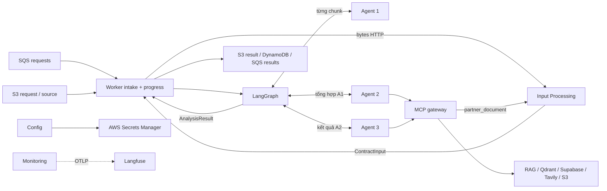

# Kiến trúc hệ thống

Tài liệu mô tả code hiện tại. Sơ đồ toàn hệ thống (web ContractGuard + AI worker + dịch vụ ngoài):
[ContractGuard-Architecture.drawio](architecture/ContractGuard-Architecture.drawio), mở và sửa bằng draw.io; xuất PNG/SVG cùng tên
khi cần ảnh. Icon dùng trong sơ đồ ở `architecture/icons/` (nguồn: `icons/sources.json`).

| Muốn biết | Đọc |
| --- | --- |
| Ba agent, prompt, model, memory, tool, RAG | [ai_agents.md](ai_agents.md) |
| Worker, giao thức ContractGuard, DynamoDB, cancel, chatbot | [workers.md](workers.md) |
| Thu thập dữ liệu pháp luật | [data_pipeline.md](data_pipeline.md) |
| Env, secret, EC2, monitoring, Langfuse, kiểm thử | [operations.md](operations.md) |
| Bản gửi đối tác về cancel và lỗi | [partner_cancel_and_failure.md](partner_cancel_and_failure.md) |

## 1. Thành phần

Một `docker-compose.yml` ở root quản lý 9 service; Dockerfile nhiều target ở `infrastructure/docker/Dockerfile`. Data pipeline
pháp luật là hai service systemd trên cùng EC2, ngoài Docker.

| Service | Trách nhiệm |
| --- | --- |
| `worker` | SQS/S3/DynamoDB, lease, tiến độ, gọi processing rồi LangGraph, trả kết quả. Không gọi agent trực tiếp |
| `input-processing` | Kiểm file, trích xuất PDF/DOCX/ảnh/TXT, OCR, làm sạch, chia chunk; trả `ContractInput` |
| `langgraph` | Thứ tự agent, bàn giao, retry, cache/resume, tính điểm, dựng `AnalysisResult` |
| `agent-1` | Tách và phân loại điều khoản, trích fact theo từng chunk |
| `agent-2` | Đánh giá rủi ro có bằng chứng |
| `agent-3` | Đề xuất sửa đổi; phục vụ chatbot (`POST /v1/chat`) |
| `mcp` | Cổng tool cho Agent 2/3; chứa RAG và các reader chỉ đọc |
| `monitoring` | Nhận sự kiện, log, metrics, alert, gửi Langfuse |
| `config` | Cấp secret theo token và allowlist từng service |

Các container không import lẫn nhau, chỉ giao tiếp HTTP. Source Hermes gốc nằm nguyên ở `agents/hermes/hermes_agent/`; phần nối
với project ở `agents/hermes/*.py`. Không sửa source upstream.

### Mạng và bảo mật trên EC2 (theo tài liệu hạ tầng và hướng dẫn kiểm thử 26/11/2026)

- EC2 AI Worker ở isolated subnet, không có đường Internet trực tiếp. AWS API đi qua VPC Endpoints; Internet chỉ ra qua EC2 Egress Proxy
  (Squid, TCP 3128, allowlist hostname; ngoại lệ Qdrant 6333). Quản trị bằng SSM Session Manager, không SSH.
- **Vai trò tách biệt:** backend đối tác ghi `quarantine/` và `request.json`; Worker chỉ đọc chúng và ghi `clean/`, `extraction.json`. Worker
  bị `AccessDenied` khi ghi `quarantine/` là đúng thiết kế; không mở quyền để test, hãy gửi job từ phía đối tác.
- **Proxy:** repo không đặt biến proxy trong Compose hay systemd. Ghi vào root `.env` thì data pipeline nhận được, còn Docker chỉ container
  `config` nhận; các service khác cần cấu hình proxy của Docker trên host. `NO_PROXY` phải có tên 9 service, `localhost`, `127.0.0.1`,
  `169.254.169.254` và `.amazonaws.com`. Đã kiểm bằng httpx và botocore: danh sách này đưa lời gọi nội bộ, AWS và IMDS đi thẳng, Gemini,
  Qdrant và Langfuse đi proxy.
- **Có trong source:** 9 container bỏ mọi capability, `no-new-privileges`, filesystem chỉ đọc, UID 10001, không mount Docker socket; hai
  service systemd có `NoNewPrivileges`, `ProtectSystem=strict`, `ProtectHome`.
- **Giới hạn cần nhớ:** container nào tới được IMDS đều dùng chung `ContractRisk-EC2-Role`. Allowlist của Config và chế độ chỉ đọc của MCP là
  lớp ứng dụng, không giới hạn quyền IAM: role đọc được cả secret JSON và (theo policy data pipeline) ghi được `legal/*`. Muốn tách phải
  dùng role riêng theo workload hoặc chặn IMDS với container không cần AWS (agent, langgraph, input-processing, monitoring).
- Sơ đồ không ghi IP máy và mã tài khoản AWS.

| Trạng thái | Kiểm soát |
| --- | --- |
| Đã quan sát trên EC2 | Ra Internet qua Squid, kết nối ngoài quy tắc từng bị `TCP_DENIED/403`; Qdrant 6333 qua proxy (collector quét 870 văn bản, `new=0`, chưa chứng minh ghi mới); quản trị bằng SSM (`ssm-user`); IAM từ chối Worker ghi `quarantine/`; MCP đọc được `request.json`, bị từ chối đọc `clean/` và `extraction.json` |
| Có trong source | Hardening container và systemd như trên; token riêng từng service; tool MCP chỉ đọc; `partner_document` chỉ đọc tài liệu của job |
| Cần xác minh | Không public IP, không route `0.0.0.0/0` và `::/0`; Security Group; VPC Endpoints và policy; IMDSv2 hop limit 2; allowlist Squid và cổng 6333 đúng hostname; role dùng chung; job E2E với đối tác; mã hóa at-rest, CloudTrail, VPC Flow Logs, Langfuse nhận trace |

## 2. Luồng một hợp đồng

1. Worker nhận message SQS, đọc `request.json`, giữ lease DynamoDB, tải file từ S3.
2. Gửi bytes tới input-processing, nhận `ContractInput` (chunk + nguồn + trang).
3. Gửi manifest tới LangGraph: Agent 1 lặp từng chunk → tổng hợp → Agent 2 → Agent 3.
4. LangGraph tính điểm, dựng và kiểm `AnalysisResult` **trước khi** đánh dấu hoàn tất.
5. Worker ghi S3 → DynamoDB → gửi `completed` → xóa message SQS.

`job_id`, `runtime_id`, `contract_id`, `trace_id`, `request_id` đi qua mọi service. `runtime_id` giữ nguyên qua các lần retry.
Hợp đồng dùng `contract_version`; `version` ở `rag/` và `data_pipeline/` là phiên bản văn bản luật, khái niệm khác.

## 3. Giao thức nội bộ

Mọi service nghe cổng 8000 trong network `backend`, không mở cổng host (trừ monitoring bind `127.0.0.1`). HTTP cần
`Authorization: Bearer INTERNAL_API_TOKEN`, trừ `/healthz` và `/readyz`. Config và MCP dùng token riêng. JSON UTF-8, tối đa 40 MiB.

Job bền vững (`common/service_jobs.py`, SQLite) dùng chung cho input-processing, LangGraph và ba agent:

| Endpoint | Ý nghĩa |
| --- | --- |
| `POST /v1/jobs` | Header `Idempotency-Key` (SHA-256); trả 202. Cùng key khác payload → 409 |
| `GET /v1/jobs/{key}` | `queued/running/completed/failed/cancelled`, stage, progress, result |
| `POST /v1/jobs/{key}/cancel` | Dừng job đang chờ hoặc đang chạy; job đã xong giữ nguyên |
| `GET /v1/describe` (agent) | agent_id, model, hash cấu hình. Hash khác → từ chối dùng cache cũ |

Lease/heartbeat chống hai runner cùng nhận một job; hết lease thì chạy tiếp sau crash. Submit lại tối đa 3 lần, chỉ với lỗi tạm
thời (`RETRYABLE_JOB_ERRORS`). Lỗi trả về chỉ có tên lớp lỗi, không có nội dung hợp đồng.

- **Worker → input-processing**: identity, job, context, file base64 (≤ 20 MiB). Trả `contract`, `stats`, `warnings`.
- **Worker → LangGraph**: identity + `ContractInput`. Khóa `workflow`, `preprocessing`, `worker` trong context được dành riêng.
- **LangGraph → agent**: identity, execution_revision, `AgentRequest`, memory snapshot. Trả `AgentResult` + snapshot mới.
- **Agent 2/3 → MCP**: streamable HTTP, `MCP_API_TOKEN`.

## 4. Schema

| Ranh giới | Nơi định nghĩa |
| --- | --- |
| ContractGuard → worker | `common/schemas/business/inbound.py` (giữ cả trường lạ; toàn bộ request vào `context.request`) |
| Processing → LangGraph | `common/schemas/contract.py` (`ContractInput`, `ContractChunk`) |
| Input/output từng agent | `agents/<agent>/schemas/input.py`, `output.py` |
| Vỏ kết quả model | `common/schemas/agent_messages.py` (`AgentResult`, `text` chứa JSON nghiệp vụ) |
| LangGraph → worker → ContractGuard | `common/schemas/business/outbound.py` (`AnalysisResult` 2.0.0, `OutboundMessage`; cấm khóa lạ) |

Schema của project viết bằng Pydantic, dựa trên dữ liệu trao đổi với ContractGuard; không chép file schema của đối tác vào repo.

## 5. Input processing

Nhận text hoặc bytes, không tự tải S3 và không gọi agent.

| Định dạng | Cách xử lý |
| --- | --- |
| PDF | `pypdf` lấy text theo trang; trang có nội dung nhưng không có text → OCR. PDF mã hóa/hỏng → lỗi. Trang lỗi `KeyError` = trang trống |
| DOCX | Đoạn, bảng, số danh sách, header/footer, note; ảnh nhúng đi qua OCR. Tracked changes, ảnh ngoài → lỗi |
| TXT | UTF-8 hoặc UTF-16 có BOM |
| PNG/JPEG/TIFF | OCR từng frame |

- OCR: Tesseract `vie+eng` (có sẵn trong image). `ocr=auto|always|never`. OCR trống, quá giờ hoặc thiếu engine → lỗi cả job.
- Nội dung phải khớp đuôi file, nếu không báo lỗi.
- Giới hạn (`ProcessingLimits`, job không tự nâng được): 20 MiB, 200 trang, 2 triệu ký tự, 25 triệu pixel, OCR 60 giây/trang ở 200 DPI.
- Chunk mặc định 512 token, overlap 0, tối thiểu 80. Không gộp hai Điều khác nhau; bảng giữ ô rỗng; không tự nối từ bị ngắt dòng.
- Ký tự nào không thuộc chunk nào → lỗi, không để mất nội dung âm thầm (`uncovered_chars`).
- Mỗi chunk giữ ID, heading, trang, `source_spans`, hash. Vị trí là ký tự trong text đã trích xuất, không phải tọa độ PDF. DOCX: `page=null`.
- Token là ước lượng theo byte UTF-8, không phải usage thật của model.

Chạy riêng: `python -m scripts.preprocess_contract --file contract.pdf --local-root uploads --contract-id HD-001 -o result.json`

## 6. Lưu trữ và giới hạn

| Dữ liệu | Nơi lưu |
| --- | --- |
| Job HTTP, cache workflow, memory agent, sự kiện monitoring | SQLite trên 7 named volume |
| Trạng thái và kết cục job | DynamoDB (2 bảng, xem [workers.md](workers.md)) |
| File và kết quả hợp đồng | S3 ContractGuard |
| Kho luật | S3 (file gốc), Supabase (cấu trúc), Qdrant (vector) |
| Model embedding/rerank | `models/` trên host, mount chỉ đọc |

- SQLite chỉ cho một host, không dùng qua NFS. Không cam kết model chỉ được gọi đúng một lần khi crash.
- Chưa có chính sách xóa cache workflow theo thời gian; monitoring thì có.
- Chưa kiểm trên AWS thật: hai worker cùng ghi S3 đúng lúc lease hết hạn.
- Danh mục BR-RISK-006, BR-RISK-007, `fact_key` chờ ContractGuard.
