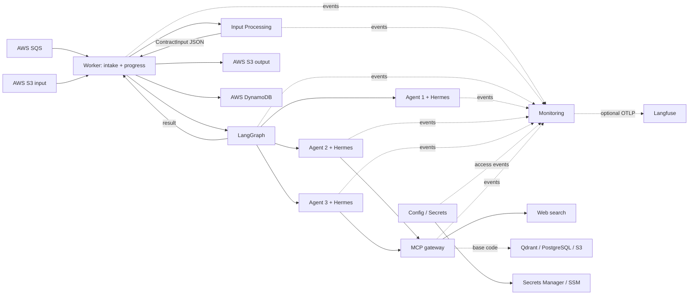

# Kiến trúc multi-container — 2026-11-07

Triển khai theo plan_work.txt; thay thế thiết kế worker image riêng trước đó.
Một docker-compose.yml ở root quản lý 8 image/service, network backend và volume.

- workers/: nhận SQS, runtime/lease/hash, tải S3, gọi HTTP processing rồi graph;
  progress process ghi S3 trước completed DynamoDB/ACK/DeleteMessage. Langfuse không
  còn quyết định trạng thái kết thúc. Reader cũ giữ cho tương thích library, Compose không dùng.
- input_processing/: logic cũ không đổi. service.py thêm durable HTTP job adapter,
  bytes base64 → process_job → ContractInput JSON, bảo toàn nguồn và metadata.
- agents/service.py: RPC dùng BaseAgent/Hermes hiện có; mỗi image chọn một AGENT_ID.
  Nhận/trả memory snapshot, validate execution revision; không clone Hermes lúc chạy.
- orchestration/: graph/chunk/aggregate/handoff cũ giữ nguyên; RemoteAgent và
  RemoteSummarizer gọi service. Durable jobs và full-result/memory cache ở volume.
- config/: broker secret có auth/allowlist theo service, AWS provider chain và
  runtime secret bootstrap. Không bake secret vào image hoặc trả qua API không auth.
- monitoring/: push event HTTP + stdout JSON, SQLite/outbox, metrics và Langfuse OTLP
  tùy chọn. Chỉ nhận field an toàn, không log contract/prompt/secret.
- common/: auth/HTTP client, bounded JSON, schema và durable job transport dùng chung.
- infrastructure/docker/: Dockerfile nhiều target; requirements khóa cross-platform.

Mỗi service có /healthz và /readyz; internal APIs yêu cầu token, Config dùng token riêng.
Không publish port host, không Docker socket. IAM/resources AWS cấp bên ngoài project.
Các Docker image độc lập chia sẻ build cache; restart/rebuild từng service bằng Compose.
SQLite volume hỗ trợ local/EC2 một host; chưa phải checkpoint đa host hoặc exactly-once
model execution. Caller vẫn có thể dùng API Python truyền ContractInput trực tiếp.

Local fixture mode dùng để xác minh kết nối, không phân tích pháp lý thật. Prompt,
model settings, memory budgets và tool/RAG nghiệp vụ còn TODO được giữ nguyên. Không
khôi phục apps/, database root, Redis/Lambda; data_pipeline vẫn là luồng kiến thức riêng.

Xem [interface](container_interfaces.md), [environment](environment.md),
[worker](workers.md), [testing](testing.md), [triển khai](deployment_ec2.md).
