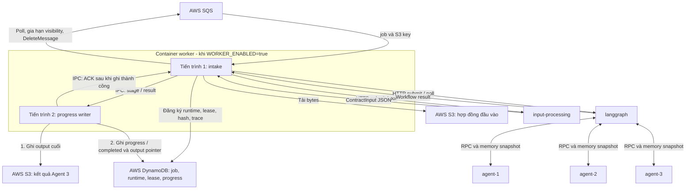
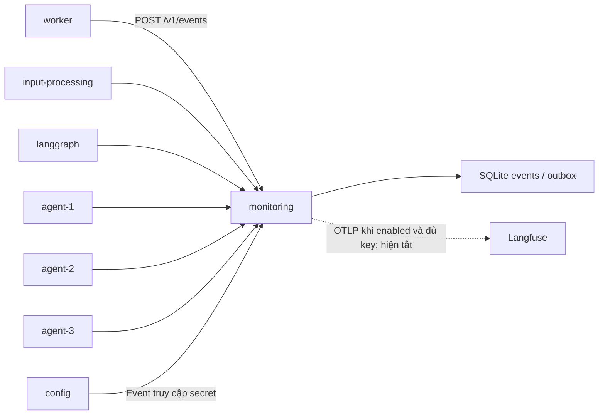

# Báo cáo tình trạng các luồng và kết nối hiện tại

> Báo cáo lịch sử ngày 2026-11-07, giữ để đối chiếu. Kiến trúc hiện hành nằm ở
> [README](../README.md) và [architecture.md](architecture.md); source Bedrock và
> plan_work_note.md nhắc bên dưới đã được thay thế hoặc bỏ khỏi repository.

**Ngày đối chiếu:** 2026-11-07, khoảng 13:59 (Asia/Saigon).  
**Căn cứ:** source code, `docker-compose.yml`, cấu hình local được kiểm tra mà không
in secret, trạng thái Docker và phản hồi `/readyz` trực tiếp của tám service.

Luồng hợp đồng đã có kết nối HTTP đầy đủ giữa các container và đã qua E2E với AWS
giả lập/model fixture. **Hệ thống đang chạy local: worker idle, ba agent dùng fixture,
Langfuse tắt. Chưa có bằng chứng kết nối AWS/Bedrock/Langfuse thật.**

Đây là ảnh chụp tình trạng tại thời điểm trên, không phải báo cáo giám sát tự cập nhật.
Tài liệu mô tả thiết kế gốc `folder-responsibilities.md` chứa cả các phần dự kiến;
báo cáo này phân biệt chúng với code và đường chạy hiện tại.

## 1. Trạng thái tám service đang chạy

Tất cả có một replica, cùng network `contract-risk_backend`, nghe cổng 8000 nội bộ.
Compose không publish cổng ra host. HTTP readiness của cả tám service đều trả thành công.

| Service | Trạng thái thực tế | Thành phần nó gọi trong đường chạy hiện tại |
| --- | --- | --- |
| `worker` | Healthy; `mode=idle`, `sqs_polling=false` | Đẩy event idle tới monitoring. Khi bật worker: SQS, S3, DynamoDB, input-processing và langgraph |
| `input-processing` | Healthy, sẵn sàng nhận job | Gọi pipeline tiền xử lý trong cùng container; đẩy telemetry tới monitoring |
| `agent-1` | Healthy; `model_provider=fixture` | BaseAgent/Hermes trong container; monitoring; chưa gọi Bedrock thật |
| `agent-2` | Healthy; `model_provider=fixture` | BaseAgent/Hermes trong container; monitoring; chưa có retrieval RAG/MCP |
| `agent-3` | Healthy; `model_provider=fixture` | BaseAgent/Hermes trong container; monitoring; chưa có retrieval RAG/MCP |
| `langgraph` | Healthy; `agent_transport=http` | Gọi ba agent qua API nội bộ, giữ workflow/cache, đẩy telemetry tới monitoring |
| `monitoring` | Healthy; `langfuse_active=false` | Nhận event, lưu SQLite/metrics; exporter Langfuse hiện không hoạt động |
| `config` | Healthy | Có API secret; policy hiện chưa cấp alias nào, chưa truy xuất secret AWS |

Bảy client có cấu hình địa chỉ Config Service, nhưng `*_SECRET_BINDINGS` đều rỗng.
Vì vậy bootstrap hiện không gửi yêu cầu lấy secret. `healthy` xác nhận service sẵn
sàng theo readiness của nó, không xác nhận đã xử lý hợp đồng thật hoặc có đủ quyền AWS.

## 2. Sơ đồ đường đi của một job khi bật worker

Sơ đồ dưới đây thể hiện kết nối đã có code. Các cạnh AWS đã được kiểm thử bằng Moto;
worker local đang idle nên không thực hiện polling AWS tại thời điểm báo cáo.
Mũi tên biểu diễn lời gọi hoặc dữ liệu trao đổi, không phải cấu hình mạng một chiều.



**Thứ tự nghiệp vụ:** xử lý từng chunk bằng Agent 1 → tổng hợp đủ chunk → Agent 2
→ Agent 3. LangGraph điều khiển thứ tự này. Ba agent không gọi trực tiếp lẫn nhau.

## 3. Bảng kết nối chính: phần nào nối với phần nào

Trong bảng, **đã nối local** nghĩa là có implementation và E2E liên container đã đạt;
**có code, chưa xác minh cloud** nghĩa là đã kiểm tra bằng giả lập nhưng chưa gọi dịch
vụ thật; **có điều kiện** nghĩa là chỉ chạy khi bật/cấp đủ cấu hình.

| Bên gọi → bên nhận | Giao thức / dữ liệu | Trạng thái và vị trí code |
| --- | --- | --- |
| Intake → SQS | boto3: nhận message, gia hạn visibility, xóa message sau hoàn tất | Có code, chưa xác minh cloud; hiện idle. [sqs_client.py](../workers/connectors/sqs_client.py), [heartbeat.py](../workers/runtime/heartbeat.py) |
| Intake → S3 input | boto3 tải file theo bucket/key/version, trả bytes + metadata | Có code, chưa xác minh cloud. [contract_source.py](../workers/connectors/contract_source.py), [s3_client.py](../workers/connectors/s3_client.py) |
| Intake → DynamoDB | Đăng ký job/runtime, claim/renew/release lease, bind source hash và trace | Có code, chưa xác minh cloud. [job_store.py](../workers/runtime/job_store.py) |
| Intake → input-processing | HTTP JSON `POST /v1/jobs`, sau đó poll `GET /v1/jobs/{key}`; gửi bytes base64 và metadata | Đã nối local. [processing_service.py](../workers/connectors/processing_service.py) → [service.py](../input_processing/service.py) |
| Input-processing → intake | Response job chứa `contract`, `stats`, `warnings`; client worker lấy `contract` | Đã nối local; không có callback ngược từ preprocessing |
| Intake → LangGraph | HTTP job API; gửi `identity` và `ContractInput` đã tiền xử lý | Đã nối local. [workflow_service.py](../workers/connectors/workflow_service.py) → [service.py](../orchestration/service.py) |
| LangGraph → Agent 1 | HTTP RPC, từng chunk + context + memory; nhận result và memory mới | Đã nối local. [remote_agent.py](../orchestration/remote_agent.py) → [agents/service.py](../agents/service.py) |
| LangGraph → Agent 2 | HTTP RPC, context chứa tổng hợp đầy đủ kết quả Agent 1 | Đã nối local; model đang là fixture. [workflow.py](../orchestration/workflow.py), [context_transfer.py](../orchestration/context_transfer.py) |
| LangGraph → Agent 3 | HTTP RPC, context chứa output Agent 2 và metadata hợp đồng | Đã nối local; model đang là fixture. Cùng adapter/workflow ở trên |
| LangGraph → intake | Worker poll result; connector lấy `results.agent_3_recommendation` từ workflow hoàn tất | Đã nối local; không có callback Agent 3 → worker trực tiếp |
| Intake → progress writer | `multiprocessing.Queue`: event tiến độ/kết quả; chờ ACK qua queue phản hồi | Đã nối và kiểm thử hai process thật. [main.py](../workers/main.py), [progress_worker.py](../workers/runtime/progress_worker.py) |
| Progress writer → S3 output | Ghi JSON output Agent 3 theo job/runtime/attempt | Có code, chưa xác minh cloud; lưu S3 trước `completed`. [progress_worker.py](../workers/runtime/progress_worker.py) |
| Progress writer → DynamoDB | Cập nhật stage/status/progress và pointer kết quả, kiểm tra owner/sequence | Có code, chưa xác minh cloud; chặn event/owner cũ ghi đè. [job_store.py](../workers/runtime/job_store.py) |

HTTP API nghiệp vụ dùng `INTERNAL_API_TOKEN`; `Idempotency-Key` giữ yêu cầu retry ổn
định. Mỗi request mang `job_id`, `runtime_id`, `contract_id`, `trace_id`, `request_id`.
Worker tự tạo runtime khi job thiếu runtime và dùng lại khi SQS gửi lại cùng job.
Chi tiết schema, giới hạn payload và retry: [container_interfaces.md](container_interfaces.md).

## 4. Tiền xử lý đã nối vào context Agent 1 như thế nào?

Đường truyền chính xác hiện tại là:

```text
Worker: tải bytes từ S3
  → input_processing/service.py
  → process_job: validation → extraction/OCR → cleaning → structure → chunk/token
  → ContractInput JSON trả về worker
  → worker gửi ContractInput cho LangGraph
  → workflow.classify_chunk gọi build_chunk_request
  → AgentRequest gửi HTTP tới agent-1
```

- `ContractInput.chunks[]` chứa text và metadata của từng chunk; metadata giữ thông
  tin nguồn, trang/element và vị trí đã được preprocessing xác định.
- `ContractInput.context.preprocessing` giữ manifest, thống kê, warnings và source hash.
- [build_chunk_request](../agents/agent_1_classification/context/context_builder.py)
  đưa metadata của chunk vào `context.workflow.source_metadata` và tạo context Agent 1.
- Agent 1 xử lý tuần tự; LangGraph giữ result/memory trong cache trước khi tổng hợp và
  chuyển sang Agent 2. Agent 2 trả output về LangGraph để đưa vào context Agent 3.
- JSON giữa các agent hiện là `AgentResult` gồm `agent_id`, `text`, `usage`,
  `stop_reason`. Các class output chuyên biệt vẫn TODO về trường/validation nghiệp vụ;
  chưa thể coi dữ liệu đã có schema hoàn chỉnh về điều khoản, điểm rủi ro hoặc khuyến nghị.

`input_processing/file_retrieval.py` đã bỏ. Preprocessing không tự tải S3, không gửi
HTTP trực tiếp tới Agent 1 và không import agent để thực thi. Kết nối context diễn ra
qua worker và LangGraph như đường truyền trên.

## 5. Tiến độ, hoàn tất và lưu kết quả

Luồng cập nhật DynamoDB hiện tại **không đi qua Langfuse hoặc Monitoring**:

```text
LangGraph: cập nhật stage/progress trong job store
  → worker intake poll trạng thái qua HTTP
  → intake gửi event qua IPC
  → progress writer cập nhật DynamoDB
```

Worker tự phát các mốc tải file, processing và lưu kết quả. Với workflow, nó chuyển
stage đang chạy từ kết quả polling sang progress writer. Các giá trị progress là mốc
tiến độ do code gán, không phải phần trăm thời gian thực hoặc số token đã xử lý.

Khi kết thúc: lấy output Agent 3 từ LangGraph → gửi IPC → ghi S3 → ghi DynamoDB
`completed` kèm pointer S3 → ACK IPC → intake kiểm tra hoàn tất → `DeleteMessage` SQS.
Nếu lưu thất bại, worker giữ message để retry. Cơ chế owner/lease/sequence bảo vệ
cập nhật, không phải quyền ghi đè vô điều kiện.

Các nguồn lưu khác nhau:

| Nơi lưu | Thành phần ghi | Nội dung |
| --- | --- | --- |
| DynamoDB AWS | Intake và progress writer | Job/runtime/lease/hash/trace, trạng thái, tiến độ, pointer output; không tự đưa toàn bộ raw contract vào progress |
| S3 output AWS | Progress writer | JSON kết quả cuối của Agent 3 |
| SQLite `/data` ở processing và từng agent | Job runner của service | Payload, trạng thái, kết quả và lease của HTTP job |
| SQLite `/data` ở LangGraph | Job runner và ContractCache | Workflow job, full results và memory snapshots để retry/resume |
| SQLite `/data` ở monitoring | Collector | Events, metrics tổng hợp khi truy vấn, outbox xuất Langfuse |

Compose cũng khai báo `worker-data:/data`, nhưng trạng thái nghiệp vụ worker hiện dùng
DynamoDB/S3; không nên hiểu volume này là kho job chính của worker. SQLite của các
service phù hợp một Docker host; chưa phải checkpoint phân tán hay exactly-once model call.

## 6. Luồng Monitoring và Langfuse



| Kết nối | Hiện trạng |
| --- | --- |
| Worker, processing, LangGraph, ba agent → monitoring | Đã nối qua [monitoring/client.py](../monitoring/client.py): HTTP có auth và JSON stdout; E2E trước đã ghi nhận event/correlation/token usage |
| Config → monitoring | Đã nối event truy cập secret khi được xử lý thành công hoặc bị từ chối; policy hiện rỗng |
| Monitoring → chính kho event của nó | Ghi trực tiếp SQLite; event startup của monitoring không cần HTTP gọi chính nó |
| Monitoring → Langfuse | Có [OTLP exporter](../monitoring/langfuse_exporter.py), hiện `langfuse_active=false`; chưa kiểm chứng endpoint thật |
| Langfuse → worker | Không nằm trong đường chạy Compose mới; worker không chờ Langfuse để cập nhật DynamoDB hoặc lấy output |

Job events mang các ID liên kết; event startup/config không nhất thiết thuộc một job
nên có thể không có `job_id`/`trace_id`. Collector lọc field, không thu raw input/output
hợp đồng. `/v1/events?trace_id=...` và `/v1/metrics` cần auth. Chưa có dashboard web
riêng trong Compose. Collector gián đoạn thì client vẫn log stdout, không làm job lỗi;
client chưa có outbox bền vững, nên không bảo đảm gửi lại mọi event bị mất.

## 7. Luồng Config/Secret và model

### Config Service

```text
.env trên host → Docker Compose → environment tương ứng trong từng container

Service có CONFIG_SECRET_BINDINGS
  → config.client.bootstrap
  → HTTP GET config:8000/v1/secrets/{alias}, dùng token riêng của service
  → kiểm tra principal + config/policy.json
  → AWS Secrets Manager hoặc SSM Parameter Store qua boto3
  → secret trả về client và đưa vào environment runtime
```

Có code cho worker, processing, ba agent, LangGraph và monitoring dùng bootstrap.
**Hiện cả bảy binding map rỗng và tất cả allowlist trong policy rỗng**: đường truy xuất
secret chưa hoạt động trong cấu hình local. Test Moto/HTTP trước đã kiểm tra cơ chế này.
Config nhận biến từ host; không có vòng Config tự gọi API của chính nó để bootstrap.
Secret không được ghi vào báo cáo, image hoặc telemetry. Chi tiết: [environment.md](environment.md).

### Agent → Hermes → model

```text
agents/service.py → BaseAgent
  → Hermes adapter / ContextEngine từ source agents/hermes/hermes_agent
  → provider được chọn
      local hiện tại: FixtureProvider
      khi cấu hình thật: HermesBedrockProvider → BedrockClient → boto3 Converse
```

Hermes được sử dụng qua adapter/module và ContextEngine trong tiến trình, không có
container Hermes riêng. Việc có Hermes source không đồng nghĩa đang chạy đầy đủ CLI
hoặc vòng lặp tự gọi tool của Hermes. LangGraph gọi agent/summarizer qua HTTP; lời gọi
model được thực hiện bên agent, không phải LangGraph gọi Bedrock trực tiếp.

Tại thời điểm báo cáo, code kết nối Bedrock nằm trong `agents/hermes/bedrock_provider.py`
và `integrations/aws/bedrock_client.py` (nay đã bỏ, dùng OpenAI). Khi đó cần model/region/IAM,
instructions và memory budgets phù hợp trước khi bật production; chưa xác minh AWS thật.

## 8. Những luồng chưa nối hoặc đã ngừng sử dụng

| Luồng / thành phần | Tình trạng dựa trên code |
| --- | --- |
| Frontend/API Gateway → upload S3, tạo job SQS | Không có backend tiếp nhận này trong project hiện tại; `apps/` đã bỏ. Producer bên ngoài phải chuẩn bị object/message |
| Worker → từng agent trực tiếp | Không có trong đường chạy; worker gọi LangGraph |
| Agent 1 → Agent 2 → Agent 3 trực tiếp | Không có HTTP trực tiếp giữa agent; LangGraph chuyển context/result |
| Agent 3 → worker trực tiếp | Không có endpoint callback này; result đi qua LangGraph và polling của worker |
| Agent 2/3 → RAG → Qdrant/PostgreSQL | Chưa nối: toàn bộ 6 file Python trong `rag/` và 3 file trong `integrations/database/` đang rỗng |
| Agent tools → MCP/legal API/web search | Chưa nối: 4 file Python trong `integrations/external/` đang rỗng. Tool wrapper cần handler được đăng ký tường minh; thiếu handler báo `IntegrationNotConfigured` |
| Model tự lựa chọn và gọi tool | Chưa có vòng lặp/tool schema tự động trong base implementation; có `run_tool` và `ToolRegistry` để gọi/đăng ký tường minh |
| Nguồn luật/thị trường/doanh nghiệp → data_pipeline → PostgreSQL/Qdrant/S3 | Chưa triển khai: cả 23 file Python trong `data_pipeline/` đang rỗng; không có ingestion service trong Compose |
| Langfuse polling/multipart preprocessing phiên bản trước | Các file `workers/connectors/langfuse.py`, `input_processing.py` và nhánh `ProgressWorker.watch` còn để tương thích library/test; entrypoint hiện tạo `ProcessingServiceClient` + `WorkflowServiceClient`, không cấu hình Langfuse reader |
| Redis, Lambda, database ở root | Đã bỏ; không có service hoặc đường kết nối hoạt động tương ứng |

Các con số file bao gồm `__init__.py`, được kiểm tra trực tiếp ở thời điểm lập báo cáo.
Biến môi trường PostgreSQL/Qdrant hoặc tên tool có sẵn không chứng minh đã có client
hay truy xuất dữ liệu chạy thực tế. Các kế hoạch trong Markdown cũng không tự thực thi.

## 9. Mức độ kiểm chứng và điểm cần làm tiếp

**Trong lần lập báo cáo này:** đọc code/cấu hình, xác nhận tám container running/healthy,
gọi `/readyz` qua HTTP trong network; kiểm tra binding/policy và các file khung. Không
đổi source nghiệp vụ, không bật polling, không restart container, không gọi cloud thật.

**Bằng chứng từ lượt triển khai trước:** 106 unit test, 4 notebook và E2E liên container
đã đạt; log E2E local vẫn ghi exit code 0. E2E dùng worker hai process thật, HTTP đến
processing/LangGraph/agent thật, Moto cho AWS và fixture cho model. Các kiểm chứng này
không đồng nghĩa đã xác minh phân tích rủi ro bằng model thật.

Các việc còn lại để vận hành luồng chính với dịch vụ thật: cấu hình AWS/IAM/SQS/S3/
DynamoDB, hoàn thiện model/instructions/memory và schema nghiệp vụ, đổi agent sang
Bedrock, bật worker, rồi chạy một job thật để xác minh. Config secrets và Langfuse là
nhánh tùy chọn, chỉ bật khi có cấu hình. RAG/MCP/data_pipeline cần được triển khai
riêng nếu muốn agent tra cứu luật/thị trường/doanh nghiệp.

Tham chiếu: [báo cáo triển khai](plan_work_report.md), [kiểm thử](testing.md),
[hướng dẫn EC2](ec2_setup_guide.md); nhật ký `plan_work_note.md` cũ không còn trong repo.

## 10. Kiểm tra lại năm điểm bàn giao theo yêu cầu (2026-11-07)

**Kết quả: cả 5/5 điểm bàn giao đạt trên hai job E2E mới**, một file TXT tiếng Việt
được chia thành 3 chunk, một ảnh PNG được xử lý bởi Tesseract thật thành 1 chunk.
AWS dùng Moto, model dùng fixture; HTTP, preprocessing, LangGraph, Hermes memory và
hai tiến trình worker chạy thật. Không phát hiện đứt luồng hoặc sai dữ liệu bàn giao
trong các ca này; không cần sửa code nghiệp vụ.

| Luồng yêu cầu | Đường thực thi và dữ liệu đã đối chiếu | Kết quả |
| --- | --- | --- |
| Worker → Text Extraction / OCR | Worker gửi bytes qua ProcessingServiceClient → API preprocessing → process_job → extract_document. Bytes nhận được trùng file S3 giả lập; PNG có segment `method=ocr`, trang 1 và nội dung OCR được nhận diện | Đạt TXT và OCR |
| Output input_processing → context Agent 1 | ContractInput trả về worker rồi vào LangGraph giữ nguyên. `chunk.text` vào `AgentRequest.content`; metadata vào `context.workflow.source_metadata`; toàn bộ `context.preprocessing` còn nguyên. Đã đối chiếu message user thực đưa vào model và memory nối tiếp cả 3 chunk | Đạt, đủ chunk đúng thứ tự |
| Output Agent 1 → context Agent 2 | LangGraph tổng hợp output từng chunk, giữ chunk_id/index/metadata/result; đưa vào `context.workflow.classification`. Đối chiếu từng output Agent 1 với aggregate và context thực nhận của model Agent 2 | Đạt, không thiếu output chunk |
| Output Agent 2 → context Agent 3 | Output Agent 2 trong graph trùng `context.workflow.risk_scoring` của request và message model Agent 3; context preprocessing và trường nhận diện test vẫn giữ | Đạt, output không bị đổi |
| Output Agent 3 → worker | Result Agent 3 → workflow result → WorkflowServiceClient → intake → IPC writer. JSON result cuối trong S3 giả lập trùng hoàn toàn result Agent 3, đúng job/runtime/contract; DynamoDB hoàn tất, SQS ACK/xóa sau đó | Đạt, đúng output và identity |

Điểm cần phân biệt: Agent 1 nhận text trong trường `content`, còn thông tin nguồn và
manifest nằm trong trường `context`. BaseAgent ghép cả hai vào message user cho model.
Các agent không gọi trực tiếp lẫn nhau; LangGraph thực hiện bàn giao. Khi vượt budget,
handoff có thể dùng bản tóm tắt kèm cache key thay full output, giữ bản đầy đủ trong
cache. Nhánh nén được kiểm tra trong bộ unit workflow; hai job E2E trên dùng full output.

### Cách xác minh và bằng chứng

- Chạy lại **44 unit test liên quan**, đều đạt: 12 workflow/context, 12 HTTP service,
  20 file extraction/OCR. Không ghi nhận đây là lần chạy lại toàn bộ 106 test.
- Bổ sung [handoff_audit.py](../tests/integration/handoff_audit.py), được gọi từ
  [container_smoke.py](../tests/integration/container_smoke.py) khi đặt `SMOKE_AUDIT_DIR`.
  Helper đọc SQLite bằng `mode=ro` từ các volume mount read-only, lọc đúng job/runtime
  giả lập mới tạo; không xuất raw payload hoặc secret ra log.
- So sánh cả request đã lưu, message user trong memory và hash input do fixture model
  trả về. Vì vậy kiểm tra được dữ liệu thực tới model, không chỉ status completed.
- Image test local không còn tồn tại khi bắt đầu lượt kiểm tra này; đã build lại riêng
  target `test`. Không rebuild/restart các service vận hành hoặc bật worker đang idle.
- Log TXT: `.cache/handoff-text.log`; log OCR: `.cache/handoff-ocr.log`. Hai file
  `handoff-text-exit.txt` và `handoff-ocr-exit.txt` đều bằng `0` trong `.cache/`.

Cách chạy lại được bổ sung tại [testing.md](testing.md). Kết quả xác minh transport và
context; không xác nhận chất lượng phân loại/chấm điểm hoặc kết nối AWS/Bedrock thật.
