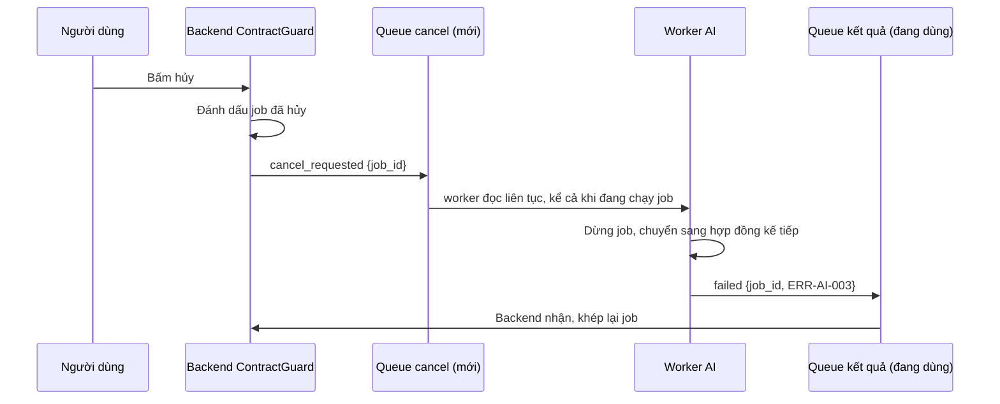

# Cancel và xử lý lỗi: hướng dẫn tích hợp cho ContractGuard

Phiên bản 1 (đề xuất), 2026-11-24. Gửi: đội backend/hạ tầng ContractGuard.

Tài liệu này bổ sung cho giao thức worker hiện có (§1–4), **không đổi** các message đang dùng. Hai phần:

1. **Cancel**: backend báo cho worker dừng một job khi người dùng bấm nút hủy.
2. **Lỗi**: worker trả gì khi không xử lý được hợp đồng.

Những chỗ ghi **[cần chốt]** là đề xuất của phía worker, xem mục 5.

## 1. Tóm tắt luồng



| Tình huống | Message cuối trên queue kết quả | File tại `result_key` |
| --- | --- | --- |
| Thành công | `completed` | Kết quả đầy đủ (extraction.v2) |
| Bị hủy | `failed` + `ERR-AI-003` | Không ghi |
| Lỗi, worker đã đọc được request | `failed` + mã lỗi | Output lỗi (mục 3.3); có thể vắng nếu chính S3 lỗi |
| Request hỏng (không đọc được hoặc sai schema) | `failed` + `ERR-AI-001` | Không ghi |

## 2. Cancel

### 2.1 Việc phía ContractGuard cần làm

1. Tạo một queue SQS **Standard** riêng cho cancel, tên gợi ý `contractguard-dev-analysis-cancels` **[cần chốt]**, vùng
   `ap-southeast-1`.
2. Cho role của worker nhận và xóa message trên queue đó (mục 2.2).
3. Gửi message cancel khi người dùng bấm hủy (mục 2.3).
4. Xử lý message trả về (mục 2.4).
5. Gửi lại cho phía worker **URL của queue**.

Phải là queue riêng: worker chỉ đọc queue `analysis-requests` giữa hai hợp đồng, nên lệnh hủy đặt ở đó sẽ tới sau khi job đã
chạy xong. **Không gửi `cancel_requested` vào `analysis-requests`**: worker coi đó là request sai và trả `failed` cho job.

### 2.2 Queue policy

Thay `<AI_ACCOUNT_ID>` và `<WORKER_ROLE>` bằng role worker đang được cấp quyền trên `analysis-requests`;
thay `<BACKEND_ROLE_ARN>` bằng role của backend.

```json
{
  "Version": "2012-10-17",
  "Statement": [
    {
      "Sid": "WorkerReadsCancels",
      "Effect": "Allow",
      "Principal": {"AWS": "arn:aws:iam::<AI_ACCOUNT_ID>:role/<WORKER_ROLE>"},
      "Action": ["sqs:ReceiveMessage", "sqs:DeleteMessage"],
      "Resource": "arn:aws:sqs:ap-southeast-1:699061129385:contractguard-dev-analysis-cancels"
    },
    {
      "Sid": "BackendSendsCancels",
      "Effect": "Allow",
      "Principal": {"AWS": "<BACKEND_ROLE_ARN>"},
      "Action": "sqs:SendMessage",
      "Resource": "arn:aws:sqs:ap-southeast-1:699061129385:contractguard-dev-analysis-cancels"
    }
  ]
}
```

Nếu queue mã hóa bằng KMS key riêng: worker cần `kms:Decrypt`; backend cần `kms:GenerateDataKey` và `kms:Decrypt`.

Cấu hình gợi ý: giữ message 1 ngày, có DLQ sau 5 lần nhận. Worker tự đặt visibility 30 giây khi đọc.

### 2.3 Message gửi đi

```json
{"message_version": "1", "event_type": "cancel_requested", "job_id": "5f0c2c1e-0000-4000-8000-000000000001"}
```

| Trường | Kiểu | Bắt buộc | Ý nghĩa |
| --- | --- | --- | --- |
| `message_version` | chuỗi, luôn `"1"` | Có | Như các message khác |
| `event_type` | chuỗi, luôn `"cancel_requested"` **[cần chốt]** | Có | |
| `job_id` | chuỗi 1–256 ký tự | Có | Đúng `job_id` đã gửi trong `analysis_requested` |

Trường lạ được bỏ qua. Message sai định dạng bị xóa, **không có trả lời**, nên hãy kiểm trước khi gửi.

Thử bằng AWS CLI:

```bash
aws sqs send-message --region ap-southeast-1 --queue-url <CANCEL_QUEUE_URL> --message-body '{"message_version":"1","event_type":"cancel_requested","job_id":"<JOB_ID>"}'
```

### 2.4 Worker trả lời

Worker không trả lời trên queue cancel. Kết quả đến qua queue `analysis-results` đang dùng, theo message `failed` sẵn có, vì
giao thức hiện chưa có event `cancelled` **[cần chốt]**:

```json
{"message_version": "1", "event_type": "failed", "job_id": "5f0c2c1e-0000-4000-8000-000000000001", "failure_reason": "Cancelled by user", "error_code": "ERR-AI-003"}
```

Nhận biết job bị hủy bằng **`error_code = "ERR-AI-003"`**, không dựa vào `failure_reason`.

| Trạng thái job lúc hủy | Worker làm gì | Backend nhận được |
| --- | --- | --- |
| Đang xử lý | Dừng trong vài giây, chuyển sang hợp đồng kế tiếp | `failed` + `ERR-AI-003` |
| Còn chờ trong `analysis-requests` | Ghi nhớ lệnh hủy; tới lượt thì bỏ qua, không xử lý | `failed` + `ERR-AI-003` **khi tới lượt message đó** |
| Đang chờ thử lại sau lỗi | Không chạy lại | `failed` + `ERR-AI-003` khi SQS giao lại (thường trong 2 phút) |
| Đã `completed` | Không đổi gì | Không có message mới; `completed` đã gửi vẫn đúng |
| Đã `failed` | Không đổi gì | Không có message mới |
| Đã hủy trước đó | Không đổi gì | Không có message mới |

Lưu ý cho backend:

- **Không chờ trả lời mới cập nhật giao diện.** Đánh dấu đã hủy ngay khi người dùng bấm; `failed` tới sau chỉ để khép lại.
- **Hủy có thể thua.** Nếu job xong ngay trước lệnh hủy, backend nhận `completed`. Mỗi lần chạy chỉ có một kết cục: đã hủy thì
  không có `completed`, đã `completed` thì không có `ERR-AI-003`.
- **Message có thể lặp** (SQS giao ít nhất một lần). Xử lý theo `job_id`, nhận lại thì bỏ qua.
- **`progress` gửi trước lúc hủy có thể tới sau `failed`**, vì queue Standard không đảm bảo thứ tự. Bỏ qua `progress` của job đã kết thúc.
- **`job_id` đã hủy là hủy vĩnh viễn.** Muốn phân tích lại, tạo `job_id` mới; cùng `contract_id` vẫn được.
- Hủy không xóa file `quarantine/`; bản `clean/` có thể đã được tạo. Backend tự dọn nếu cần.

## 3. Khi xử lý lỗi

### 3.1 Khi nào worker báo lỗi

| Loại lỗi | Cách xử lý |
| --- | --- |
| Lỗi đầu vào: request sai, file rỗng hoặc quá `max_bytes`, loại file đọc được khác `declared_file_type`, quá `max_pages` | Dừng ngay, gửi `failed` (`ERR-AI-001` hoặc `ERR-UPL-004`) |
| Lỗi khác: dịch vụ, model, mạng; file hỏng, nội dung không khớp đuôi file, hoặc trên 200 trang | SQS giao lại; lần nhận thứ 3 vẫn lỗi thì dừng, gửi `failed` (`ERR-AI-002`) |

Trong lúc thử lại, worker **không** gửi `failed`. Backend có thể thấy `progress` quay về `reading_file`; đó là lần chạy mới.

Hãy giữ giới hạn 20 phút không có message của backend: nếu máy worker chết đúng lần thử cuối, message vào DLQ và không có `failed`.

### 3.2 Message `failed` (schema không đổi)

```json
{"message_version": "1", "event_type": "failed", "job_id": "5f0c2c1e-0000-4000-8000-000000000001", "failure_reason": "Remote job failed: RemoteServiceError", "error_code": "ERR-AI-002"}
```

| `error_code` | Ý nghĩa | Gợi ý cho người dùng |
| --- | --- | --- |
| `ERR-UPL-004` | Quá số trang cho phép (mã sẵn có của ContractGuard) | Tải file ngắn hơn |
| `ERR-AI-001` **[cần chốt]** | Request hoặc file không hợp lệ; gửi lại y nguyên sẽ vẫn lỗi | Kiểm tra file |
| `ERR-AI-002` **[cần chốt]** | Không xử lý được sau nhiều lần thử; gồm cả file hỏng | Thử lại sau với `job_id` mới, hoặc kiểm tra file |
| `ERR-AI-003` **[cần chốt]** | Người dùng hủy | Không hiển thị như lỗi |

`failure_reason` dài tối đa 300 ký tự, để ghi log, không chứa nội dung hợp đồng và không cố định; đừng so khớp chuỗi này. Ví dụ:

- `Document has 101 pages; the request allows 100`
- `File content is docx, request declared pdf`
- `Remote job failed: RemoteServiceError`

### 3.3 Output lỗi tại `result_key`

Trước khi gửi `failed`, worker ghi `results/<job_id>/extraction.json` đúng `result_key` trong request. File có **đủ mọi mục cấp
cao nhất** của kết quả bình thường; mục không có giá trị là `null`:

```json
{
  "schema_version": "2.0.0",
  "job_id": "5f0c2c1e-0000-4000-8000-000000000001",
  "contract_id": "c0ffee00-0000-4000-8000-000000000009",
  "contract_version": "2",
  "document_complete": false,
  "document": null,
  "clauses": null,
  "metadata": null,
  "findings": null,
  "checks": null,
  "facts": null,
  "injection_warnings": null,
  "overall_recommendation": null,
  "scoring": null,
  "trace": null
}
```

Quy tắc cho backend:

- **Chỉ coi file là kết quả sau khi nhận `completed`.** Nhận `failed` thì không nạp file này vào báo cáo.
- Không chạy kiểm tra extraction.v2 trên output lỗi: các mục bắt buộc đang là `null` nên sẽ không đạt. Đó là chủ đích.
- Nhận ra output lỗi: `document_complete = false` **và** `clauses = null`.
- Lý do lỗi nằm trong message `failed`, không nằm trong file.
- Nếu có trigger khi file xuất hiện trên S3, hãy bỏ trigger đó hoặc kiểm điều kiện trên.
- File `quarantine/` được giữ nguyên khi lỗi.

Không cần cấp thêm quyền S3: worker vẫn chỉ ghi `results/*/extraction.json`.

## 4. Kịch bản nghiệm thu

| # | Thao tác | Kỳ vọng |
| --- | --- | --- |
| 1 | Gửi job dài, đợi `progress`, rồi gửi cancel | `failed` + `ERR-AI-003` trong vài giây; không có `completed` |
| 2 | Gửi hai job, hủy job thứ nhất khi đang chạy | Job thứ hai vẫn `completed` |
| 3 | Gửi cancel trước, rồi gửi `analysis_requested` cùng `job_id` | `failed` + `ERR-AI-003`; không có `progress` |
| 4 | Hủy job đã `completed` | Không có message mới, kết quả giữ nguyên |
| 5 | Gửi cancel hai lần cho cùng job | Backend chỉ khép job một lần |
| 6 | Gửi file `.docx` nhưng khai `declared_file_type = "pdf"` | `failed` + `ERR-AI-001`; `result_key` có output lỗi |
| 7 | Gửi PDF 101–200 trang với `max_pages = 100` | `failed` + `ERR-UPL-004`; `result_key` có output lỗi |
| 8 | Gửi file `.pdf` hỏng | Không có `failed` ở hai lần đầu; sau lần nhận thứ 3: `failed` + `ERR-AI-002`; `result_key` có output lỗi |
| 9 | `request.json` thiếu trường bắt buộc | `failed` + `ERR-AI-001`; `result_key` không có file |

## 5. Cần hai bên chốt

| # | Nội dung | Đề xuất hiện tại của worker |
| --- | --- | --- |
| 1 | Tên queue cancel và URL | `contractguard-dev-analysis-cancels` |
| 2 | Tên event hủy | `cancel_requested` |
| 3 | Báo kết quả hủy bằng gì | `failed` + `ERR-AI-003`; nếu ContractGuard muốn thêm event `cancelled`, worker sẽ đổi theo |
| 4 | Mã `ERR-AI-001/002/003` | Tạm dùng, chờ danh mục mã lỗi của ContractGuard |
| 5 | Output lỗi tại `result_key` có trùng quy ước nào của backend không | Ghi file như mục 3.3; có thể tắt nếu không cần |
| 6 | File hỏng nên báo `ERR-AI-001` ngay thay vì `ERR-AI-002` sau 3 lần thử? | Hiện là `ERR-AI-002`; worker đổi được |

Trạng thái phía worker: đã viết xong và kiểm thử với AWS giả lập; chưa chạy với queue thật của ContractGuard. Sau khi có URL queue,
phía worker cấu hình, triển khai bản mới, rồi hai bên chạy mục 4.
